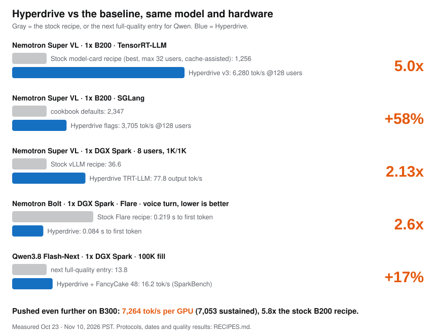

<picture>
  <source media="(prefers-color-scheme: dark)" srcset="assets/banner-dark.svg">
  
</picture>

<p align="center">
  <a href="LICENSE"></a>
  
  
  
  <a href="https://github.com/Hyperdrive-Project/recipes/releases"></a>
</p>

**Hyperdrive recipes for open source models and engines.** Each recipe tunes one open model on one machine, end to end:
the serving engine, kernels, speculative decoding, batching and memory. Every recipe ships with its configs, patches,
benchmark protocol and quality gate, so every number below can be checked from one clone.

<p align="center"><picture>
  <source media="(prefers-color-scheme: dark)" srcset="assets/highlights-dark.svg">
  
</picture></p>

## At a glance

| Model | GPU | Engines | Best result | Speedup |
|---|---|---|---|---|
| [Nemotron 3.5 Super VL](#nemotron-35-super-vl-120b-a12b-nvfp4) | B300 | TensorRT-LLM, vLLM | **7,264 tok/s per GPU** | **5.8x** the stock B200 recipe |
| | B200 | TensorRT-LLM, SGLang, vLLM | **6,280 tok/s per GPU** | **5.0x** the stock recipe at its 32-user max (cache-assisted); SGLang **+58%** |
| | DGX Spark | TensorRT-LLM | 77.8 tok/s at 8 users | up to **2.13x** the stock recipe |
| [Nemotron 3.5 Bolt](#nemotron-35-bolt-real-time-voice) | DGX Spark | Flare | **0.084 s** to first token | **2.6x** faster first token |
| [Qwen3.8 Flash-Next](#qwen38-flash-next-fp4-local) | DGX Spark | vLLM | **49.8 / 25.7 / 16.2 tok/s** (SparkBench) | fastest full-quality entry, **+10-17%** |

## Quick start

Run `./hyperdrive detect` to see the recipes for your GPU, or pick a row below and follow that folder's README.

| You have | You want | Run |
|---|---|---|
| 1x B300 or B200 | max throughput for Nemotron 3.5 Super VL | [`nemotron-super-vl/`](nemotron-super-vl/README.md#quick-start-tensorrt-llm): build the image, `scripts/serve.sh configs/b300/hyperdrive-b300-v3.yaml ...` |
| 1x B200, SGLang or vLLM stack | Super VL without custom images | [`configs/sglang/serve-b200.sh`](nemotron-super-vl/configs/sglang/serve-b200.sh) or [`configs/vllm/serve-hyperdrive.sh`](nemotron-super-vl/configs/vllm/serve-hyperdrive.sh) |
| 1x DGX Spark | Super VL for a few users | [`nemotron-super-vl/`](nemotron-super-vl/README.md#quick-start-tensorrt-llm) with `configs/spark/` |
| 1x DGX Spark | real-time voice | [`bolt-flare-voice/serve/serve-bolt.sh`](bolt-flare-voice/README.md#run-it) |
| 1x DGX Spark | a fast local chat / agent model | [`qwen-flash-next/serve.sh`](qwen-flash-next/serve.sh) |

Then check speed and quality on your own box:

```bash
python3 correctness/eval.py --label mine --tasks math,code,tools --reasoning on      # quality gate
nemotron-super-vl/scripts/aiperf_sweep.sh 8192 1024 "1 8 32 64 128"                # throughput, unique prompts
```

**Using a coding agent?** Tell it "set up the best Hyperdrive recipe for this machine". It can run
`./hyperdrive detect`, then `./hyperdrive run <id>`, using [AGENTS.md](AGENTS.md), [recipes.json](recipes.json) and
[llms.txt](llms.txt). The CLI is Python standard library only, and it never downloads or starts anything without `--yes`.

## Recipes

Throughput is output tok/s per GPU at 8K tokens in / 1K out (AIPerf 0.13). Quality is math / code / tools with reasoning
on (GSM8K 50, HumanEval 30, 11 tool calls). Every result with its date and status: [RECIPES.md](RECIPES.md).

### Nemotron 3.5 Super VL (120B-A12B, NVFP4)

Folder: [`nemotron-super-vl/`](nemotron-super-vl/README.md)

**B300**

| Engine | Result | vs baseline | Quality | Run |
|---|---|---|---|---|
| TensorRT-LLM 1.4.0rc1 + Hyperdrive **v3** | **7,264 burst / 7,053 sustained** at 160 users | **5.8x** the stock model-card recipe on B200 (1,256; there is no stock B300 run) | 49/50, 29/30, 11/11 | [`b300-v3`](nemotron-super-vl/configs/b300/hyperdrive-b300-v3.yaml) |
| TensorRT-LLM + Hyperdrive **v2** (no weight changes) | 6,752 / 6,723 at 160 users | – | 48/50, 29/30, 11/11 | [`b300-v2`](nemotron-super-vl/configs/b300/hyperdrive-b300-v2.yaml) |
| vLLM 0.32.0, stock image + Hyperdrive flags | 6,470 at 160 users (cache-assisted) | – | 49/50, 29/30, 11/11 | [`vllm`](nemotron-super-vl/configs/vllm/serve-hyperdrive.sh) |

**B200**

| Engine | Result | vs baseline | Quality | Run |
|---|---|---|---|---|
| TensorRT-LLM + Hyperdrive **v3** | **6,280 / 6,307** at 128 users | **5.0x** the stock model-card recipe (its best: 1,256 at 32 users, its limit; measured cache-assisted, which favors the baseline) | passed on B300 | [`b200-v3`](nemotron-super-vl/configs/b200/hyperdrive-b200-v3.yaml) |
| SGLang, stock image + Hyperdrive flags | **3,705** at 128 users, 3,622 at 160 | **+58%** vs cookbook defaults (2,347) | 48/50, 29/30, 11/11 | [`sglang`](nemotron-super-vl/configs/sglang/serve-b200.sh) |
| vLLM 0.32.0, stock image + Hyperdrive flags | 5,567 at 128 users (cache-assisted) | – | 49/50, 29/30, 11/11 | [`vllm`](nemotron-super-vl/configs/vllm/serve-hyperdrive.sh) |

**DGX Spark**

| Engine | Result | vs baseline | Quality | Run |
|---|---|---|---|---|
| TensorRT-LLM + Hyperdrive + LiLiCorr drafter | 39.0 tok/s at 1 user, 77.8 at 8 users (1K/1K) | **1.06-2.13x** the stock vLLM recipe | GSM8K 98.8%, HumanEval 98.8% | [`spark`](nemotron-super-vl/configs/spark/hyperdrive-spark.yaml) |

What makes it fast:
- **Speculative decoding** that's lossless: MTP with rejection sampling (B200/B300), LiLiCorr drafter (Spark).
- **Mamba kernels:** CAKE Mamba-2 SSD prefill (FlashInfer), a Triton varlen conv1d, FP8 Mamba norm.
- **Scheduling:** 64K prefill chunks, prefix-cache reuse off for unique-prompt serving, TensorRT-LLM's no-op guided-decoding drains skipped.
- **v3 only:** the 80 Mamba-2 projections re-quantized from FP8 to NVFP4. It's a weight change, so v2 ships alongside it.
- **SGLang:** a fix for the Mamba state cache, which caps stock SGLang at 27 concurrent requests. Two flags lift it to 98.

### Nemotron 3.5 Bolt (real-time voice)

Folder: [`bolt-flare-voice/`](bolt-flare-voice/README.md)

**DGX Spark**

| Engine | Result | vs baseline | Quality | Run |
|---|---|---|---|---|
| NVIDIA Flare + Hyperdrive patches | **0.084 s** to first token, **~0.30 s** to first spoken phrase, 60.8 tok/s decode | **2.6x** faster first token, **~2x** faster first phrase, **+60%** decode vs the stock recipe | 48/50, 27-29/30, 11/11 | [`serve-bolt.sh`](bolt-flare-voice/serve/serve-bolt.sh) |

What makes it fast:
- One-step prefill for short prompt tails.
- A speech-sized package: 2 users and 16 speculative rows.
- Fixed-width verify with 4 drafts.
- The persona prompt is warmed into the prefix cache at boot.

It's the brain of a fully local Reachy Mini robot: speech-to-text, Bolt and text-to-speech all run on one Spark.

### Qwen3.8 Flash-Next FP4-Local

Folder: [`qwen-flash-next/`](qwen-flash-next/README.md)

**DGX Spark**

| Engine | Result | vs baseline | Quality | Run |
|---|---|---|---|---|
| vLLM (eugr b12x) + Hyperdrive overlays + **FancyCake 48** | **SparkBench PBM 49.8 / 25.7 / 16.2 tok/s** at 4K / 50K / 100K (mean of 5) | **+9.7% / +13.7% / +17.4%** vs the next full-quality entry | GSM8K 49/50, HumanEval 28/30, tools 11/11 | [`serve.sh`](qwen-flash-next/serve.sh) |

What makes it fast:
- A 34K-token MTP draft vocabulary and a recurrent-state checkpoint before each prompt end.
- **FancyCake 48:** static NVFP4 expert scales, worth 5.2% faster decode at the same quality.

> **FancyCake kernels.** FancyCake 48 comes from FancyCake, a forthcoming Hyperdrive project for kernel work. This recipe
> ships the finished kernel change only; the tool itself is not part of this repo.

It's the fastest full-quality (FP4-Local, all 10 experts) Flash-Next entry on DGX Spark in SparkBench PBM, but not the
fastest build overall. A reduced INT4 build (50.2 / 26.6 / 15.4) leads at 4K and 50K. That build routes 5 experts per
token instead of 10, which may cost accuracy; no accuracy results are published for it.

## How we measure

- **Same model:** the published checkpoint with all experts, and speculation that only keeps tokens the full model would
  have produced. Where a recipe changes numerics beyond the published recipe, it says so: **v3** re-quantizes the 80 Mamba-2 projections from FP8 to
  NVFP4 (v2 ships alongside with no weight changes), and the **SGLang** recipe keeps the Mamba state in BF16.
- **Quality gate:** reasoning on, run on the same items for the baseline and the recipe ([`correctness/`](correctness/README.md)).
  Both numeric changes above passed it. B200 v3 was not gated on its own; it uses the weights and kernels that passed on B300.
- **Unique prompts:** every measured prompt is new. We found that a common AIPerf setup replays warm-up prompts, so about
  half of them get served from cache. The few older numbers measured that way are labeled *cache-assisted*.
- **Contributing back:** what we find goes upstream. We've sent fixes and reports to TensorRT-LLM, SGLang and AIPerf;
  [BUGS.md](nemotron-super-vl/docs/BUGS.md) lists each one with its repro and the interim workaround used here.

## Coming soon

Two more Hyperdrive projects are on the way.

**FancyCake** · finds your GPU and model, then optimizes their kernels automatically. Its first kernel already ships in the Qwen recipe above (5.2% faster
decode, same quality). Much more is coming.

**Hyperspeed** · video diffusion at warp speed. **4-5x faster than stock LTX-2.5** for 1080p clips on one RTX 5090.

⭐ Star or watch this repo to hear first.

## Layout

```
nemotron-super-vl/  Nemotron 3.5 Super VL: Dockerfile, configs (b200, b300, spark, sglang, vllm), patches, scripts, docs
bolt-flare-voice/   Nemotron 3.5 Bolt on Flare for real-time voice on Spark: patch series, serve, latency probes
qwen-flash-next/    Qwen3.8 Flash-Next on Spark: serve.sh, overlays, FancyCake 48, quality results
correctness/        shared quality suite (math, code, tools, images, needle) with pinned datasets
benchmarks/         shared helpers used by the quality suite and single-user benches
RECIPES.md          every result with date, protocol and status
AGENTS.md, llms.txt guides for coding agents and LLM tools
recipes.json        machine-readable catalog of every recipe (commands, endpoint, results)
hyperdrive          one-command picker and launcher: detect, list, show, run, check
```

## Built on

Hyperdrive stands on great open source: [TensorRT-LLM](https://github.com/NVIDIA/TensorRT-LLM),
[vLLM](https://github.com/vllm-project/vllm), [SGLang](https://github.com/sgl-project/sglang),
[NVIDIA Flare](https://github.com/NVIDIA/flare-local-inference), [FlashInfer](https://github.com/flashinfer-ai/flashinfer)
and [AIPerf](https://github.com/ai-dynamo/aiperf), and the open Nemotron and Qwen models. The recipes are configs and
small patches on top of that work. When a change belongs upstream we send it there, and we expect these recipes to get
simpler as upstream releases pick those changes up. Thank you to everyone who builds them.

## Using these recipes

Use them, fork them, ship them. If they help you, we'd appreciate a mention of "Hyperdrive recipes" with a link back here,
and a ⭐ on this repo so more people can find it.
To cite it in a paper or write-up, use [CITATION.cff](CITATION.cff).

## License

Apache-2.0 ([LICENSE](LICENSE)). Third-party pieces and their licenses: [NOTICE](NOTICE). Model weights aren't included
and are covered by NVIDIA's license. This project is independent and not endorsed by NVIDIA.
